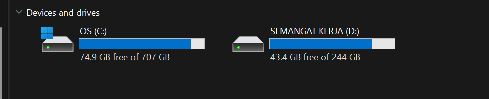
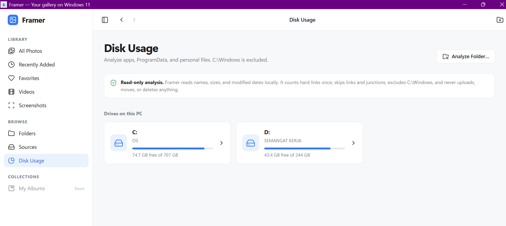
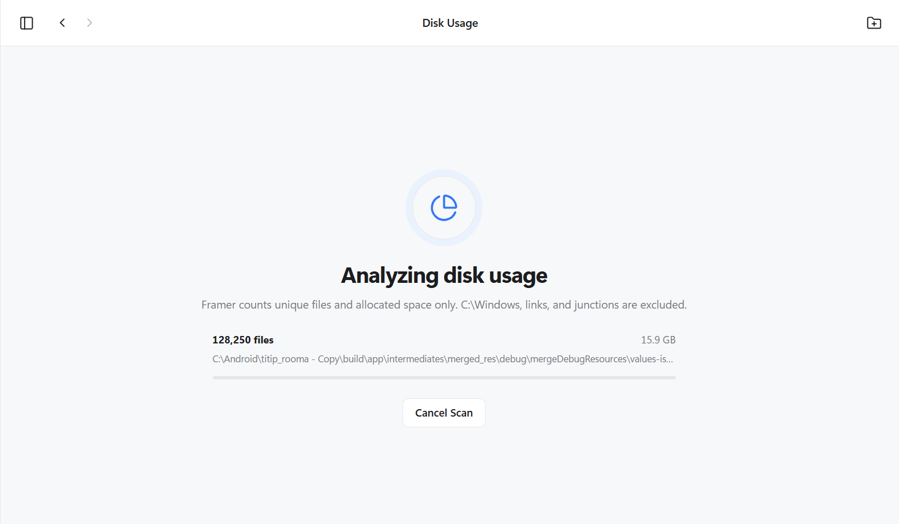
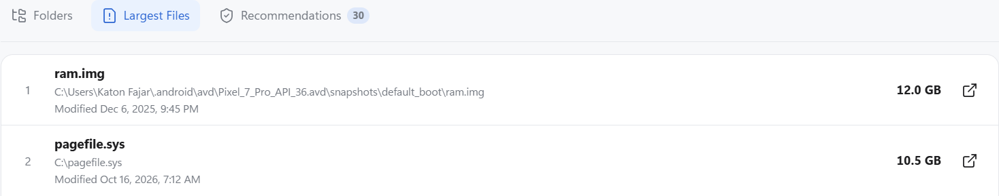
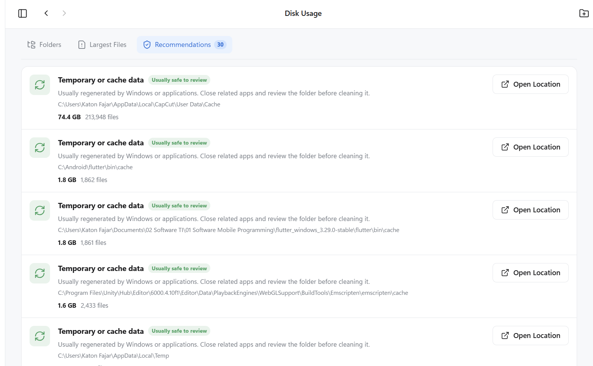

# Disk C Penuh? Cara Cek File Terbesar di Windows 11 (Cache CapCut Sampai 74 GB)

Drive C: saya berkapasitas 707 GB, dan ruang kosongnya tinggal 74,7 GB. Masalahnya bukan cuma ruang yang menipis. Saya tidak tahu file mana yang boleh dihapus, dan menghapus sembarangan di Windows adalah cara cepat untuk membuat masalah baru.

Setelah memindai seluruh drive, saya menemukan hal-hal yang tidak saya sadari ada di sana: snapshot emulator Android sebesar 12 GB dan cache CapCut sebesar **74,4 GB** di folder AppData. Tulisan ini menjelaskan cara saya menemukannya dan cara membersihkannya tanpa merusak apa pun.

Alat yang saya pakai adalah [Framer](https://github.com/katonfajar123/framer), aplikasi galeri lokal untuk Windows 11 yang saya buat. Salah satu fiturnya, Disk Usage, memindai drive dan menunjukkan di mana ruang terpakai. Bagian itu hanya membaca. Ia tidak pernah menghapus file.

## Kenapa disk C bisa penuh tanpa terasa

Kebanyakan panduan yang saya baca berhenti di tiga saran: jalankan Disk Cleanup, nyalakan Storage Sense, dan kosongkan Recycle Bin. Ketiganya berguna. Menurut [dokumentasi Microsoft](https://support.microsoft.com/en-us/windows/manage-drive-space-with-storage-sense-654f6ada-7bfc-45e5-966b-e24aded96ad5), Storage Sense membersihkan file sementara, Recycle Bin, dan isi folder Downloads yang lama tidak dibuka.

Yang tidak dijawab ketiganya adalah pertanyaan paling mendasar: **folder atau aplikasi mana yang sebenarnya memakan ruang?** Padahal penyebab yang sering muncul justru di luar cakupan alat bawaan:

- cache aplikasi di folder `AppData`, misalnya editor video, browser, dan aplikasi chat;
- snapshot emulator dan mesin virtual;
- cache tool pengembangan seperti Flutter dan Unity;
- file besar yang pernah kamu unduh dan lupa.

Melihat ukuran folder satu per satu lewat Properties di File Explorer memang bisa, tetapi tidak masuk akal untuk drive dengan jutaan file.

## Langkah 1: lihat dulu angka yang sebenarnya

Buka File Explorer dan lihat ruang kosong tiap drive. Saat saya mengecek, drive C: tampil seperti ini.

*Drive C: tersisa 74,9 GB dari 707 GB menurut File Explorer.*

Di halaman Disk Usage, Framer menampilkan drive yang sama. Angkanya 74,7 GB kosong dari 707 GB. Selisih 0,2 GB kemungkinan muncul karena kedua tangkapan layar tidak diambil pada detik yang sama.

*Halaman Disk Usage di Framer. Di bagian atas ada penegasan bahwa analisis ini read-only.*

## Langkah 2: scan seluruh drive

Klik drive C:, lalu biarkan Framer bekerja. Selama scan berjalan, kamu melihat jumlah file, total ukuran, dan folder yang sedang dibaca. Scan bisa dibatalkan kapan saja, dan berjalan di thread terpisah sehingga tampilan tidak membeku.

*Progres scan: jumlah file, ukuran yang sudah terbaca, dan path folder yang sedang diproses.*

Drive saya berisi jutaan file, jadi scan penuh memang butuh waktu. Itulah harga dari membaca semuanya, bukan hanya folder yang kamu curigai.

Sebelum membaca hasilnya, ada tiga aturan hitung yang perlu kamu tahu. Framer sengaja tidak menghitung `C:\Windows`, melewati symlink dan junction, dan menghitung hard link satu kali supaya total tidak membengkak. Karena itu total hasil scan tidak harus sama persis dengan angka terpakai di Explorer.

## Langkah 3: baca tiga tab hasilnya

Hasil scan dibagi menjadi tiga tab.

**Folders** menampilkan folder dari yang terbesar, lengkap dengan jumlah file dan persentasenya. Kamu bisa masuk ke tiap folder untuk menelusuri sampai ke penyebab.

**Largest Files** mengurutkan file besar dari yang terbesar. Di sini saya menemukan dua file teratas:

*Dua file terbesar di drive C saya.*

1. `ram.img`, 12,0 GB, di `C:\Users\Katon Fajar\.android\avd\Pixel_7_Pro_API_36.avd\snapshots\default_boot\`. Ini snapshot emulator Android yang terakhir diubah Desember 2025. Kalau emulatornya memang sudah tidak dipakai, hapus lewat Device Manager di Android Studio, bukan dengan menghapus file satu per satu.
2. `pagefile.sys`, 10,5 GB. Ini file sistem Windows untuk memori virtual. **Jangan dihapus manual.**

**Recommendations** mengumpulkan lokasi yang layak ditinjau, diberi label risiko. Tab inilah yang mengarahkan saya ke penghemat ruang terbesar.

## Studi kasus: cache CapCut 74,4 GB

Di tab Recommendations, entri teratas adalah folder cache CapCut. Ukurannya 74,4 GB, isinya 213.948 file.

*Rekomendasi pembersihan di Framer. Entri teratas: cache CapCut 74,4 GB dengan 213.948 file.*

Path lengkapnya `C:\Users\Katon Fajar\AppData\Local\CapCut\User Data\Cache`. Kamu bisa membukanya sendiri dengan menekan `Win + R` lalu mengetik `%LocalAppData%\CapCut\User Data\Cache`.

Saya tidak menemukan penjelasan resmi kenapa cache CapCut bisa sebesar itu, jadi saya tidak akan menebak penyebabnya. Yang jelas, folder itu memakan ruang jauh lebih banyak daripada gabungan semua file besar lain di daftar saya.

Folder ini adalah cache, bukan proyek. Menurut [ulasan lokasi folder CapCut di blog Ultimate Systems](https://blog.usro.net/es/2025/08/carpetas-y-cache-de-capcut-rutas-en-mac-y-pc/), proyek dan draft berada di folder lain. Karena itu yang layak dibersihkan hanya isi folder `Cache`, bukan folder di sekitarnya.

Entri lain di daftar yang sama:

| Lokasi | Ukuran | Catatan |
| --- | --- | --- |
| `...\CapCut\User Data\Cache` | 74,4 GB | Cache aplikasi editing video |
| `C:\Android\flutter\bin\cache` | 1,8 GB | Cache Flutter SDK, biasanya diunduh ulang saat dibutuhkan |
| `...\Unity\Hub\Editor\...\emscripten\cache` | 1,6 GB | Ada di Program Files, sebaiknya jangan disentuh manual |
| `AppData\Local\Temp` | - | Folder sementara Windows dan aplikasi |

Label "Usually safe to review" di Framer artinya **layak ditinjau**, bukan "hapus otomatis". Framer menandainya dari nama foldernya. Keputusan akhirnya tetap di kamu.

## Cara menghapus dengan aman

Di Disk Usage tidak ada tombol hapus, dan itu disengaja. Tiap hasil punya tombol **Open Location** yang membuka File Explorer tepat di folder tersebut. Kamu melihat sendiri isinya sebelum memutuskan.

Urutan yang aman:

1. **Kenali dulu foldernya.** Pastikan itu cache atau file sementara, bukan data yang tidak bisa dibuat ulang.
2. **Tutup aplikasinya sepenuhnya**, termasuk di System Tray dan Task Manager.
3. **Cadangkan proyek penting** kalau aplikasinya menyimpan proyek di dekat folder cache.
4. **Hapus isi foldernya**, bukan folder induknya (`User Data`, `AppData`, atau folder proyek).
5. **Cek Recycle Bin.** File yang dihapus biasa tetap memakan ruang sampai Recycle Bin dikosongkan.
6. **Jalankan aplikasinya lagi** dan pastikan semuanya normal.

Yang sebaiknya tidak disentuh: `pagefile.sys`, isi `C:\Windows`, isi `Program Files`, dan folder proyek.

Setelah dibersihkan, folder Cache CapCut di komputer saya kini kosong. Aplikasinya akan membuat cache baru saat dipakai lagi, jadi folder ini perlu dicek berkala.

## Kenapa saya membuat ini sendiri

Alat penganalisis disk sudah ada banyak, dan saya membandingkannya di [artikel review Framer](/id/blog/review-framer-analisa-disk-windows-11-vs-wiztree-windirstat-treesize). Alasan saya membuat sendiri sederhana: saya ingin satu aplikasi lokal yang menunjukkan **apa** yang memakan ruang dan **di mana** letaknya, tanpa bisa merusak file saya, dan tanpa mengunggah apa pun ke luar komputer.

Framer juga galeri foto dan video untuk folder yang sudah ada di komputer. Ia tidak mengimpor, menyalin, atau mengunggah file.

## Coba sendiri

Framer open source dengan lisensi MIT: [github.com/katonfajar123/framer](https://github.com/katonfajar123/framer). Kamu membutuhkan Windows 11, Rust, dan Node.js 20 ke atas. Langkah menjalankannya ada di README.

Kalau disk C kamu sedang menipis, mulai dari ini: lihat daftar file terbesar dan tab rekomendasi sebelum menghapus apa pun. Satu folder cache bisa lebih besar daripada semua file lain yang kamu curigai.

## Pertanyaan yang sering muncul

**Kenapa disk C penuh sendiri padahal saya tidak install apa-apa?**
Biasanya karena data yang dibuat aplikasi tanpa kamu sadari: cache dan file sementara di `AppData`, snapshot emulator, sisa pembaruan Windows, dan isi folder Downloads yang menumpuk. Cara tercepat mencarinya adalah memindai seluruh drive dan mengurutkan hasilnya berdasarkan ukuran.

**Apakah aman menghapus cache CapCut?**
Umumnya cache dibuat ulang oleh aplikasinya, jadi menghapus isi folder `Cache` tidak menghapus proyek. Tutup CapCut dulu, hapus isinya saja, dan cadangkan proyek penting. Saya tidak menemukan panduan resmi yang menjamin hal ini, jadi tetap berhati-hati.

**Di mana lokasi cache CapCut di Windows?**
Di komputer saya: `C:\Users\<nama-pengguna>\AppData\Local\CapCut\User Data\Cache`. Jika CapCut dipasang dari Microsoft Store, datanya bisa berada di tempat lain.

**Apakah Framer menghapus file saya?**
Tidak. Disk Usage hanya membaca nama, ukuran, dan tanggal ubah file secara lokal. Ia tidak menghapus, memindahkan, atau mengunggah apa pun.

**Bolehkah `pagefile.sys` dihapus?**
Jangan dihapus manual. Itu file sistem Windows untuk memori virtual. Kalau ingin mengubah ukurannya, gunakan pengaturan virtual memory Windows.

**Apakah folder AppData boleh dihapus?**
Jangan hapus seluruh folder `AppData`. Periksa subfolder tertentu yang besar, misalnya `Cache` atau `Temp`, satu per satu dan dengan aplikasinya tertutup.
