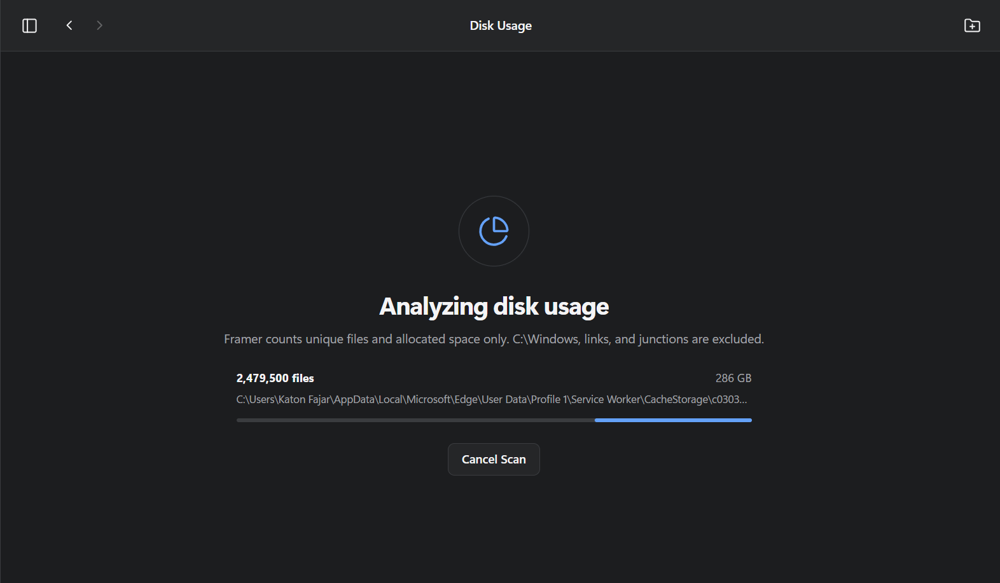

# Review Framer: Analisa Disk Windows 11 vs WizTree, WinDirStat, dan TreeSize

**Disclosure:** saya yang membuat Framer. Anggap tulisan ini ulasan dari pembuatnya. Untuk menjaga perbandingan tetap adil, data aplikasi lain saya ambil dari halaman resmi masing-masing per 16 Oktober 2026. Ini bukan benchmark head-to-head. Kekurangan Framer saya tulis lengkap di bagian tersendiri.

Alasan awalnya sederhana. Drive C: saya menipis dan saya tidak tahu file mana yang aman dihapus. Dari scan penuh, saya menemukan [cache CapCut sebesar 74,4 GB](/id/blog/disk-c-penuh-cara-cek-file-terbesar-windows-11) dan snapshot emulator 12 GB yang tidak saya sadari ada. Tulisan ini menjelaskan apa yang bisa dilakukan Framer, apa yang tidak, dan kapan kamu sebaiknya memilih aplikasi lain.

## Apa itu Framer

Framer adalah galeri foto dan video lokal untuk Windows 11, dibuat dengan Tauri 2, Rust, dan antarmuka TypeScript tanpa framework. Ia membangun galeri dari file yang sudah ada di komputer. Tidak ada impor, salinan, atau unggahan. Framer dirilis open source dengan [lisensi MIT](https://github.com/katonfajar123/framer).

Salah satu modenya adalah **Disk Usage**, penganalisis ruang drive yang hanya membaca. Bagian inilah yang dibahas di sini.

## Fitur Disk Usage

*Halaman awal Disk Usage: pilih drive, atau pilih folder lewat Analyze Folder.*

- **Scan drive atau folder.** Pilih drive utuh seperti `C:\` atau `D:\`, atau satu folder tertentu.
- **Progres langsung dan bisa dibatalkan.** Kamu melihat jumlah file, ukuran yang sudah terbaca, dan path yang sedang diproses. Tombol Cancel Scan membatalkannya kapan saja.
- **Tiga tab hasil.** *Folders* menelusuri hierarki dengan ukuran, jumlah file, dan persentase. *Largest Files* mengurutkan file besar. *Recommendations* mengumpulkan lokasi yang layak ditinjau.
- **Open Location.** Tiap file atau rekomendasi punya tombol yang membuka File Explorer tepat di lokasinya.
- **Label risiko.** Cache dan folder sementara diberi label "Usually safe to review". Selebihnya diberi "Review carefully".
- **Kartu ringkasan.** Persentase drive terpakai, total ukuran dan jumlah file, area terbesar, serta "scan quality": berapa file yang dilewati karena tidak bisa diakses, lama scan, dan penanda jika daftar folder dibatasi.
- **Tema terang dan gelap.** Mengikuti tema Windows.

*Tampilan scan dalam mode gelap. Tombol Cancel Scan selalu tersedia.*

*Tab Recommendations. Teks di aplikasinya menyebut bahwa rekomendasi adalah petunjuk, bukan keputusan menghapus.*

### Aturan hitung yang dipakai

- Hard link NTFS dihitung satu kali berdasarkan Windows File ID, sehingga total tidak membengkak.
- Symlink, junction, dan reparse point dilewati supaya tidak terjadi penelusuran berulang.
- `C:\Windows` dikecualikan dari analisis drive. Program Files dan ProgramData tetap dihitung.
- Daftar file terbesar memuat file di atas 100 MB (150 teratas). Rekomendasi mencakup folder cache atau temp di atas 50 MB, folder Downloads di atas 500 MB, dan file di atas 1 GB. Maksimal 30 rekomendasi.

## Fitur galeri

Framer bukan hanya penganalisis disk. Fitur galerinya ikut membantu saat kamu membersihkan folder media.

- **Library** dengan timeline per tahun, bulan, dan hari, memakai grid virtual yang tetap ringan walau berisi puluhan ribu foto.
- **Folders** yang menampilkan struktur folder asli.
- **Pencarian** (`Ctrl+F`) untuk nama file, folder, format, tahun, dan tanggal.
- **Viewer dan Quick Look** (`Space`), dengan zoom, informasi file, dan data EXIF.
- **Favorit** yang tersimpan terpisah, sehingga scan ulang tidak menghapusnya.
- **Aman secara desain.** "Remove from Framer" hanya melupakan indeks. "Move to Recycle Bin" adalah aksi terpisah yang harus dikonfirmasi dan memakai Recycle Bin Windows.

## Benefit yang saya rasakan

1. **Menjawab "apa" dan "di mana" sekaligus.** Tab Recommendations dan Largest Files menunjuk lokasi yang spesifik, bukan hanya angka total.
2. **Framer sendiri tidak bisa menghilangkan file.** Disk Usage tidak punya tombol hapus. Penghapusan baru terjadi kalau kamu membuka lokasinya dan menghapus sendiri di File Explorer, jadi keputusan terakhir selalu di tanganmu.
3. **Menemukan hal yang tidak kamu sadari ada.** Karena memindai semuanya, hasilnya memuat snapshot emulator, cache tool pengembangan, dan cache aplikasi di `AppData`.
4. **Satu aplikasi lokal.** Analisa disk dan galeri media ada di tempat yang sama, tanpa akun dan tanpa unggahan.
5. **Bisa dibaca dan diubah.** Kodenya terbuka. Kalau aturan rekomendasi kurang pas, kamu bisa mengubahnya.

## Perbandingan dengan aplikasi lain

Tanda "—" berarti tidak disebut di halaman resmi yang saya baca, bukan berarti fiturnya tidak ada.

| Aspek | Framer | WizTree | WinDirStat | TreeSize Free | Storage Sense (Windows) |
| --- | --- | --- | --- | --- | --- |
| Lisensi | Open source (MIT) | Gratis untuk pemakaian pribadi; komersial berbayar | Gratis, open source (GPL v3 atau lebih baru) | Gratis untuk pemakaian pribadi non-komersial | Bawaan Windows |
| Platform | Windows 11 | Windows dan macOS | Windows | Windows (tidak untuk Windows Server) | Windows |
| Cara scan | Menelusuri folder | Membaca MFT NTFS langsung | Mode elevated untuk mempercepat scan NTFS lokal | — | Tidak memindai per folder |
| Treemap | Tidak ada | Ya | Ya (juga sunburst dan flame graph) | Ya | Tidak |
| Daftar file terbesar | Ya | Ya | — | Filter Top Largest Files ada di edisi berbayar | — |
| Saran pembersihan | Ya, dengan label risiko | — | Menyediakan cleanup tools | — | Pembersihan otomatis |
| Pencari duplikat | Belum | Ya | — | Edisi berbayar | Tidak |
| Hard link dihitung sekali | Ya | Ya | — | — | — |
| Menghapus dari aplikasi | Tidak (sengaja) | — | — | — | Ya, lewat Temporary files dan pembersihan otomatis |
| Galeri foto dan video | Ya | Tidak | Tidak | Tidak | Tidak |

Sumber: [WizTree](https://diskanalyzer.com/), [WinDirStat](https://windirstat.net/), [TreeSize Free](https://www.jam-software.com/treesize_free), dan [dokumentasi Storage Sense dari Microsoft](https://support.microsoft.com/en-us/windows/manage-drive-space-with-storage-sense-654f6ada-7bfc-45e5-966b-e24aded96ad5).

Beberapa catatan dari halaman-halaman itu:

- **WizTree** mengklaim membaca MFT langsung "like Everything Search does" dan "46x faster than WinDirStat". Itu klaim resmi, bukan hasil pengukuran saya. Ia juga menyebut tidak menghitung hard link lebih dari sekali.
- **WinDirStat** menyebut dirinya "disk usage analyzer and cleanup assistant" yang gratis dan open source, bisa memindai beberapa folder, drive, share jaringan, atau perangkat MTP.
- **TreeSize Free** gratis untuk pemakaian pribadi di lingkungan non-komersial dan menyediakan treemap serta laporan PDF. Fitur seperti file duplikat dan perbandingan penggunaan dari waktu ke waktu ada di edisi berbayar.
- **Storage Sense** berfokus pada pembersihan otomatis: file sementara, Recycle Bin, folder Downloads, dan konten cloud yang bisa dijadikan online-only. Halaman dokumentasinya tidak menjelaskan cara melihat folder terbesar.

## Kekurangan Framer

Ini bagian yang tidak akan kamu temukan di halaman promosi.

- **Tidak ada treemap.** Hasilnya berupa daftar folder bertingkat dengan bilah persentase. Kalau kamu berpikir secara visual, WizTree, WinDirStat, dan TreeSize lebih nyaman.
- **Bukan yang tercepat.** Framer menelusuri folder, tidak membaca MFT. Pada versi awal, scan drive C: saya dengan sekitar 3,5 juta file memakan 347,4 detik. Perbaikan akurasi membuat pemeriksaan per file lebih berat dan scan melambat. Optimasi sesudahnya membuka tiap file satu kali, bukan empat kali, dan memprosesnya secara paralel, sehingga biaya per file turun. Angka scan penuh yang baru belum saya ukur, jadi saya tidak mencantumkannya.
- **Versi awal sempat salah hitung.** Pada drive 707 GB, versi awal melaporkan 1,6 TB, angka yang jelas mustahil. Perbaikannya: hard link dihitung satu kali, symlink dan reparse point dilewati, dan `C:\Windows` dikecualikan.
- **Perbaikan itu punya harga.** Pada iCloud Drive yang saya periksa, semua file bertanda reparse point, termasuk yang sudah tersimpan di disk. OneDrive Files On-Demand memakai mekanisme yang sama. Karena reparse point dilewati, file-file itu tidak ikut terhitung, sehingga total bisa lebih kecil dari pemakaian sebenarnya.
- **Angka ukuran bisa berbeda dari Explorer.** Untuk file biasa, Framer memakai ukuran logis, belum dibulatkan ke ukuran cluster seperti "Size on disk". Untuk beberapa file besar selisihnya kecil. Untuk jutaan file kecil selisihnya bisa terasa.
- **Rekomendasi hanya dari nama folder.** Framer baru mengenali folder bernama `Cache`, `Code Cache`, `AppData\Local\Temp`, dan `Windows\Temp`, ditambah Downloads dan file sangat besar. Cache yang namanya lain tidak ditandai.
- **Belum ada pencari duplikat.** README menyebutnya sebagai rencana fase berikutnya.
- **Windows 11 saja, dan masih versi 0.1.** Saat ini kamu menjalankannya dari source dengan Rust dan Node.js.

## Mana yang sebaiknya kamu pilih

| Kebutuhan | Pilihan yang masuk akal |
| --- | --- |
| Scan tercepat dan visualisasi treemap | WizTree |
| Gratis, open source, dengan cleanup tools | WinDirStat |
| Laporan PDF dan tampilan sederhana untuk pemakaian pribadi | TreeSize Free |
| Perawatan otomatis tanpa memasang apa pun | Storage Sense |
| Analisa disk read-only, rekomendasi berlabel, dan galeri media lokal dalam satu aplikasi | Framer |

Aplikasi-aplikasi ini tidak saling meniadakan. Saya sendiri menganggap Framer paling berguna sebagai langkah pertama yang aman: lihat apa yang ada, ketahui lokasinya, lalu putuskan sendiri.

## Cara mencoba Framer

Kodenya ada di [github.com/katonfajar123/framer](https://github.com/katonfajar123/framer). Kamu membutuhkan Windows 11, Rust (toolchain MSVC), dan Node.js 20 ke atas. Perintah `npm install` lalu `npm run desktop` menjalankannya. Detail lengkapnya ada di README.

Kalau kamu menemukan bug atau punya usulan, baca dulu panduan kontributor di repositorinya. Laporan keamanan sebaiknya lewat jalur privat di `SECURITY.md`.

## Pertanyaan yang sering muncul

**Lebih baik mana, Framer atau WizTree?**
Tergantung kebutuhan. WizTree membaca MFT NTFS langsung, menurut klaim resminya jauh lebih cepat, dan punya treemap serta pencari duplikat. Framer tidak punya keduanya, tetapi menggabungkan analisa disk read-only, rekomendasi berlabel risiko, dan galeri lokal. Kalau kamu hanya butuh scan tercepat dan visualisasi, pilih WizTree.

**Apakah Framer gratis?**
Ya, open source dengan lisensi MIT.

**Apakah Framer menghapus file?**
Tidak. Disk Usage hanya membaca. Ia memberi lokasi lewat Open Location, dan keputusan menghapus tetap kamu ambil sendiri di File Explorer.

**Apakah Framer mengirim data saya ke internet?**
Tidak. Analisis berjalan di komputermu, dan Framer tidak mengimpor, menyalin, atau mengunggah file.

**Apakah Framer bisa dipakai di Windows 10?**
README menyebut Windows 11 sebagai kebutuhan. Saya belum menguji versi lain.

**Aplikasi analisa disk gratis apa yang bagus untuk Windows?**
WizTree, WinDirStat, dan TreeSize Free adalah pilihan yang sudah mapan, dengan syarat lisensi masing-masing seperti di tabel. Framer cocok jika kamu juga ingin galeri lokal dan analisa yang hanya membaca.
